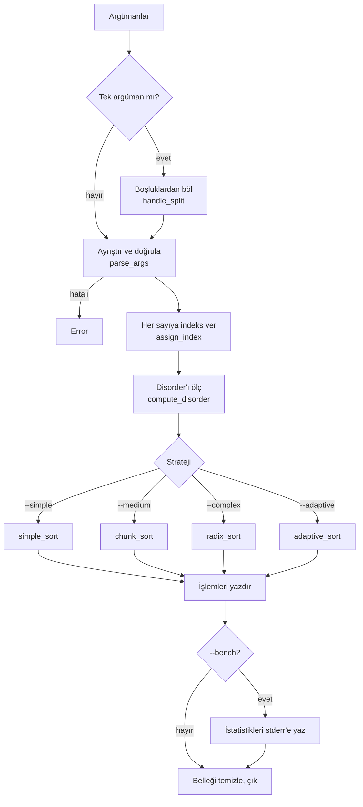

# push_swap


İki stack ve sınırlı sayıda işlemle bir tam sayı dizisini **mümkün olan en az hamlede**
sıralayan bir C programı.

Klasik push_swap'tan farkı, program girdinin **ne kadar karışık olduğunu ölçüyor**
ve buna göre dört farklı sıralama stratejisinden birini seçiyor. `--bench` moduyla
hangi stratejinin seçildiğini ve kaç hamle yapıldığını raporluyor.

---

## İçindekiler

- [Problem](#problem)
- [Derleme ve kullanım](#derleme-ve-kullanım)
- [Programın akışı](#programın-akışı)
- [Veri yapıları](#veri-yapıları)
- [İndeksleme](#indeksleme)
- [Disorder metriği](#disorder-metriği)
- [Stratejiler](#stratejiler)
- [Performans](#performans)
- [Hata yönetimi](#hata-yönetimi)
- [Test etme](#test-etme)
- [Proje yapısı](#proje-yapısı)
- [Ekip](#ekip)

---

## Problem

Elimizde iki stack var: **`a`** ve **`b`**. Başta tüm sayılar `a`'da, `b` boş.
Amaç `a`'yı küçükten büyüğe (en küçük en üstte) sıralamak. Kullanılabilecek
tek araç şu 11 işlem:

| İşlem | Ne yapar? | Örnek (`a` üstten alta) |
| --- | --- | --- |
| `sa` | `a`'nın en üstteki iki elemanını yer değiştirir | `2 1 3` → `1 2 3` |
| `sb` | Aynısını `b` için yapar | |
| `ss` | `sa` ve `sb` birlikte | |
| `pa` | `b`'nin en üstündeki elemanı `a`'nın üstüne taşır | |
| `pb` | `a`'nın en üstündeki elemanı `b`'nin üstüne taşır | |
| `ra` | `a`'yı yukarı döndürür: ilk eleman sona gider | `1 2 3` → `2 3 1` |
| `rb` | Aynısını `b` için yapar | |
| `rr` | `ra` ve `rb` birlikte | |
| `rra` | `a`'yı aşağı döndürür: son eleman başa gelir | `1 2 3` → `3 1 2` |
| `rrb` | Aynısını `b` için yapar | |
| `rrr` | `rra` ve `rrb` birlikte | |

Program, sıralamak için kullandığı işlemleri sırayla ekrana yazar. Puanı belirleyen
şey **işlem sayısıdır**: ne kadar az, o kadar iyi.

**Örnek:** `3 2 1` dizisi iki hamlede sıralanır:

```
a: 3 2 1   →  sa   →  a: 2 3 1   →  rra  →  a: 1 2 3  ✓
```

---

## Derleme ve kullanım

```bash
make        # push_swap programını derler (libft dahil)
make clean  # .o dosyalarını siler
make fclean # .o dosyalarını ve programı siler
make re     # baştan derler
```

```bash
./push_swap 4 67 3 87 23          # sayılar ayrı argüman olarak
./push_swap "4 67 3 87 23"        # tek bir string içinde
./push_swap --complex 5 1 4 2 3   # strateji seçerek
./push_swap --bench 5 1 4 2 3     # sonunda istatistik yazdırarak
```

### Bayraklar

| Bayrak | Strateji | Algoritma | Karmaşıklık |
| --- | --- | --- | --- |
| `--simple` | Simple | Küçük diziler için sabit kurallar, büyükler için selection | O(n²) |
| `--medium` | Medium | Chunk sort | O(n√n) |
| `--complex` | Complex | Radix sort (100 ve altı için chunk sort) | O(n log n) |
| `--adaptive` | Adaptive *(varsayılan)* | Disorder'a göre en uygun stratejiyi seçer | duruma göre |
| `--bench` | | Bitince disorder, strateji ve işlem sayılarını `stderr`'e yazar | |

### `--bench` çıktısı

İstatistikler `stderr`'e yazıldığı için checker'a giden işlem listesine karışmaz:

```
$ ./push_swap --bench 5 3 1 4 2 > /dev/null
[bench] disorder: 70.00%
[bench] strategy: Adaptive / O(n^2)
[bench] total_ops: 8
[bench] sa: 0  sb: 0  ss: 0  pa: 2  pb: 2
[bench] ra: 4  rb: 0  rr: 0  rra: 0  rrb: 0  rrr: 0
```

---

## Programın akışı



1. **Argümanlar okunur.** Tek bir argüman varsa (`"3 2 1"`) boşluklardan bölünür.
   Bayraklar (`--simple`, `--bench` …) ayıklanır, kalanlar sayı olarak işlenir.
2. **Her sayı doğrulanır.** Geçerli bir tam sayı mı, `int` sınırları içinde mi,
   daha önce eklendi mi? Biri bile hatalıysa program `Error` yazıp çıkar.
3. **İndeksler atanır** ve **disorder ölçülür** (aşağıda anlatılıyor).
4. **Strateji çalışır.** Her işlem hem ekrana yazılır hem de `t_ops` sayaçlarına eklenir.
5. `--bench` verildiyse istatistikler yazılır, en sonda bütün bellek serbest bırakılır.

---

## Veri yapıları

Stack'ler **tek yönlü bağlı liste** olarak tutuluyor. Listenin başı stack'in tepesi:

```c
typedef struct s_node
{
    int             value;   // girilen sayı
    int             index;   // sıralı hâlindeki yeri (0, 1, 2, …)
    struct s_node   *next;
}   t_node;
```

Her işlemin kaç kez kullanıldığı `--bench` için bir sayaç yapısında tutuluyor:

```c
typedef struct s_ops
{
    int sa, sb, ss, pa, pb, ra, rb, rr, rra, rrb, rrr;
    int total;
}   t_ops;
```

Kullanıcının seçtiği strateji ve bench modu da `t_config` içinde taşınıyor.

---

## İndeksleme

Algoritmalar sayıların kendisiyle değil, **sıralı hâldeki yerleriyle** çalışıyor.
Her sayıya, kendisinden küçük kaç sayı olduğu kadar bir indeks verilir:

```
değer:   42   -7   1000   3
indeks:   2    0      3   1
```

Bunun iki faydası var:
- Sayılar ne kadar büyük ya da negatif olursa olsun indeksler hep `0 … n-1` arasında kalır.
- Radix sort için negatif sayılarla uğraşmak gerekmez, bitlere doğrudan bakılabilir.

---

## Disorder metriği

Disorder, bir dizinin ne kadar karışık olduğunu `0` ile `1` arasında bir sayıyla
ifade eder. Bütün sayı çiftlerine bakılır ve **yanlış sırada olan çiftlerin oranı**
hesaplanır:

```
disorder = yanlış sıradaki çift sayısı / toplam çift sayısı
```

**Örnek:** `2 1 3` dizisinde 3 çift var: `(2,1)` yanlış, `(2,3)` doğru, `(1,3)` doğru.

```
disorder = 1 / 3 = %33
```

| Disorder | Anlamı |
| --- | --- |
| `0.00` | Dizi zaten sıralı |
| `≈ 0.50` | Tamamen rastgele |
| `1.00` | Tamamen ters sıralı |

---

## Stratejiler

### Adaptive: hangi durumda hangi strateji?

```
eleman sayısı ≤ 5   →  Simple    (küçük dizi, sabit kurallar en iyisi)
disorder < 0.2      →  Simple    (neredeyse sıralı, az eleman yer değiştirecek)
disorder < 0.5      →  Medium    (orta karışıklık)
disorder ≥ 0.5      →  Complex   (çok karışık, hamle sayısı tahmin edilebilir olsun)
```

Mantık şu: Neredeyse sıralı bir dizide az sayıda eleman yerinde değildir, bu yüzden
basit yöntem az hamleyle biter. Dizi karıştıkça daha "akıllı" algoritmalar öne geçer.

### Simple: O(n²)

- **2 eleman:** Gerekirse tek bir `sa`.
- **3 eleman:** 3 sayının 6 olası sıralaması var. Her biri için en kısa çözüm
  doğrudan yazılmış, en fazla **2 hamle**:

  | Durum | Çözüm |
  | --- | --- |
  | `1 2 3` | — |
  | `2 1 3` | `sa` |
  | `3 2 1` | `sa` `rra` |
  | `3 1 2` | `ra` |
  | `1 3 2` | `sa` `ra` |
  | `2 3 1` | `rra` |

- **Daha fazlası:** En küçük eleman bulunur ve hangi yoldan daha yakınsa (`ra` ile
  yukarıdan ya da `rra` ile aşağıdan) tepeye getirilip `b`'ye atılır. 3 eleman
  kalınca yukarıdaki kurallarla sıralanır, sonra `b`'dekiler sırayla `a`'ya alınır.
  Her adımda en küçüğü seçtiği için bu bir **selection sort**.

### Medium: chunk sort, O(n√n)

Diziyi indeks aralıklarına (chunk) bölüp her seferinde bir aralığı `b`'ye taşır.

1. Chunk sayısı dizi boyutuna göre seçilir:

   | Boyut | Chunk sayısı | Örnek |
   | --- | --- | --- |
   | ≤ 10 | 2 | |
   | 11 – 50 | 5 | |
   | 51 – 200 | 8 | 100 sayı → her chunk'ta yaklaşık 12 indeks |
   | > 200 | 11 | 500 sayı → her chunk'ta yaklaşık 45 indeks |

2. **İtme aşaması:** Sırayla her chunk için, `a`'da o aralıkta olan elemanlar en kısa
   yoldan tepeye getirilip `b`'ye atılır. Böylece `b`'ye önce küçükler, sonra büyükler
   gider.
3. **Geri alma aşaması:** `b`'deki **en büyük** eleman en kısa yoldan tepeye getirilip
   `a`'ya alınır. Bu her seferinde tekrarlandığında `a` küçükten büyüğe dolmuş olur.

Chunk'lar sayesinde `b` kabaca sıralı kalır ve en büyüğü bulmak için uzağa gitmek
gerekmez.

### Complex: radix sort, O(n log n)

İndeksler ikili sayı (binary) olarak düşünülür ve **en sağdaki bitten başlayarak**
her bit için bir tur yapılır:

- Biti `0` olan eleman → `pb` (`b`'ye)
- Biti `1` olan eleman → `ra` (`a`'da sona)
- Tur bitince `b`'deki her şey `pa` ile `a`'ya geri alınır.

**Örnek:** `3 -1 7 2` dizisinin indeksleri `2 0 3 1`, ikili hâlleri `10 00 11 01`.

```
Başlangıç           a: 2  0  3  1
1. tur (sağ bit)    2→pb 0→pb 3→ra 1→ra, sonra pa pa
                    a: 2  0  3  1   (sağ biti 0 olanlar başta)
2. tur (sol bit)    2→ra 0→pb 3→ra 1→pb, sonra pa pa
                    a: 0  1  2  3  ✓
```

n sayı için `log₂(n)` tur yapılır, her turda her eleman bir kez işlem görür. Bu
yüzden hamle sayısı neredeyse sabittir. 500 sayıda girdi ne olursa olsun yaklaşık
6800 hamle sürer. 100 ve daha az elemanda chunk sort daha az hamle yaptığı için
o kullanılır.

---

## Performans

Rastgele dizilerle ölçülen ortalama hamle sayıları:

| Boyut | Adaptive | Simple | Medium | Complex |
| ---: | ---: | ---: | ---: | ---: |
| 3 | 1 | 1 | 1 | 1 |
| 5 | 8 | 8 | 8 | 7 |
| 100 | 781 | 1458 | 778 | 781 |
| 500 | 7220 | 32701 | 7408 | 6784 |

Neredeyse sıralı girdilerde Adaptive, Simple'ı seçerek çok daha az hamleyle bitirir:
100 sayıda ortalama **355** hamle (rastgelede 781).

---

## Hata yönetimi

Aşağıdaki durumlarda program `stderr`'e `Error` yazar ve `1` koduyla çıkar:

| Durum | Örnek |
| --- | --- |
| Sayı olmayan argüman | `1 a 3`, `+`, `-` |
| `int` sınırlarının dışında sayı | `2147483648`, `-2147483649`, `99999999999999999999` |
| Tekrar eden sayı | `1 2 2`, `-0 0` |
| Bilinmeyen bayrak | `--foo` |

Argüman verilmezse ya da dizi zaten sıralıysa program hiçbir şey yazmaz.

Hata durumunda da program çıkmadan önce ayırdığı bütün belleği serbest bırakır.
Bunu macOS'un `leaks` aracıyla doğruladık, sonuç **0 leak**.

---

## Test etme

**Doğruluk:** 42'nin verdiği checker ile sonucun gerçekten sıralı olduğunu kontrol et:

```bash
ARG="4 67 3 87 23"; ./push_swap $ARG | ./checker_Mac $ARG   # OK
```

**Hamle sayısı:** 500 rastgele sayıyla:

```bash
ARG=$(python3 -c "import random; print(*random.sample(range(-10000, 10000), 500))")
./push_swap $ARG | wc -l
```

**Bellek sızıntısı:**

```bash
leaks --atExit -- ./push_swap 3 2 1 5 4          # macOS
valgrind --leak-check=full ./push_swap 3 2 1 5 4 # Linux
```

---

## Proje yapısı

```
.
├── Makefile
├── push_swap.h              # yapılar ve bütün fonksiyon prototipleri
├── src/
│   ├── main.c               # programın akışı
│   ├── parse.c              # argümanları ayrıştırma, tek string'i bölme
│   ├── parse_helpers.c      # bayraklar, sayı doğrulama, ft_atol, tekrar kontrolü
│   ├── assign_index.c       # her sayıya sıralı indeks verme
│   ├── strategy.c           # strateji seçimi, isim ve karmaşıklık etiketi
│   └── error.c              # belleği temizleyip "Error" yazma
├── stack/                   # bağlı liste: düğüm oluşturma, ekleme, boyut, temizleme
├── operations/              # sa sb ss · pa pb · ra rb rr · rra rrb rrr
├── algorithms/
│   ├── simple_sort.c        # 2-3 eleman kuralları + selection
│   ├── chunk_sort.c         # chunk sort
│   ├── radix_sort.c         # radix sort
│   └── adaptive_sort.c      # disorder'a göre strateji seçimi
├── metrics/disorder.c       # disorder hesabı
├── bench/benchmark.c        # --bench çıktısı
└── libft/                   # kendi C kütüphanemiz
```

---

## Ekip

| | |
| --- | --- |
| **Emrullah Taşcı** | [@emrullahtasci](https://github.com/emrullahtasci) |
| **Miraç Ege Kotan** | [@Mirac-Ege](https://github.com/Mirac-Ege) |

42 Kocaeli, 2026
